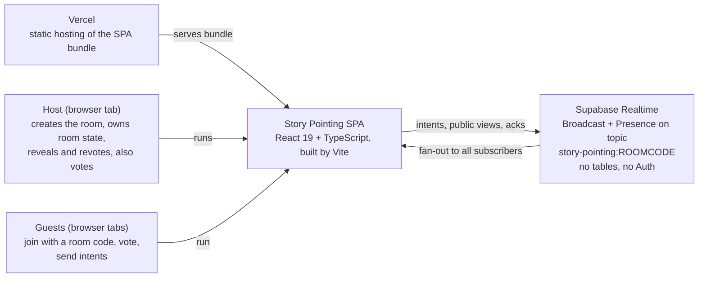
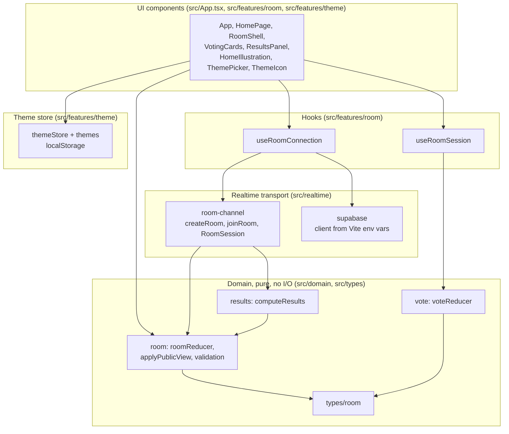
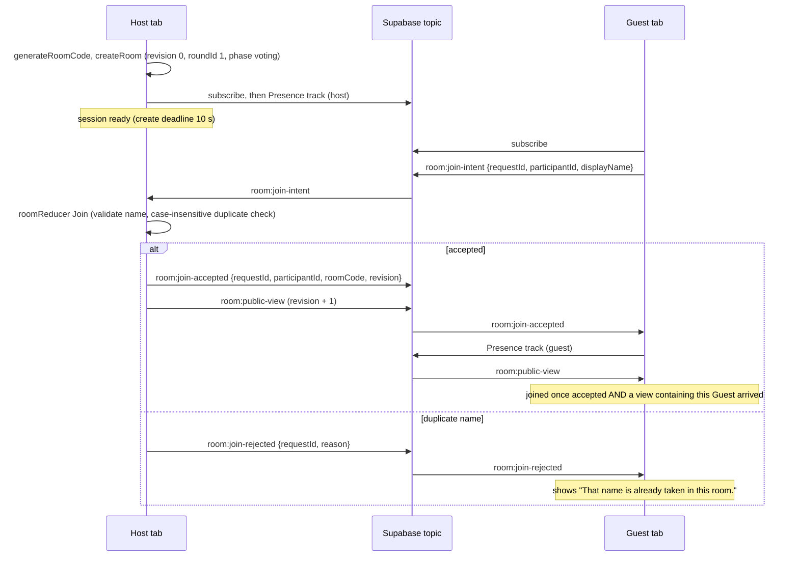
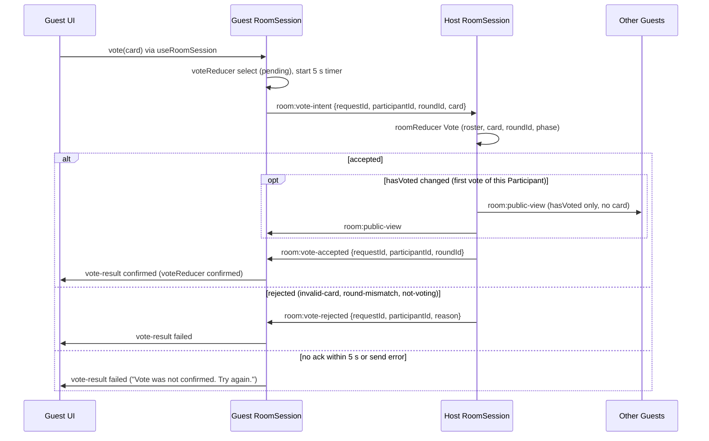
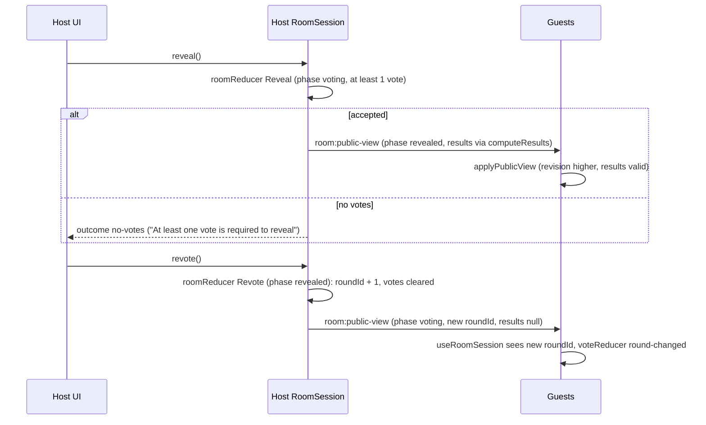
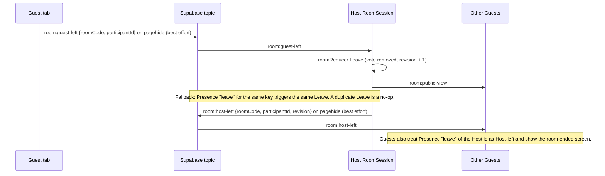
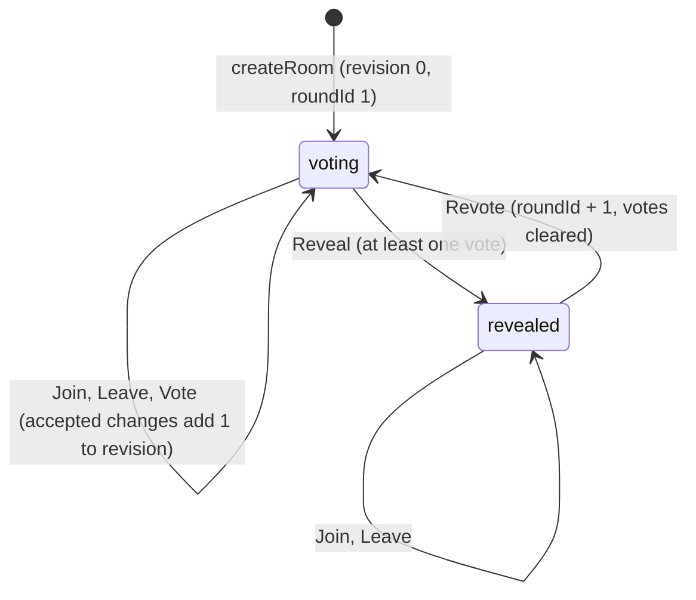

# Solution Architecture Document — Story Pointing

**Status:** describes the architecture as read from the code in `src/`, the [decisions](../knowledge/decisions.md) and the dev specs. It is not a test result; check results live in `docs/reviews/`. Anything that could not be confirmed is listed in section 12 instead of being guessed.
**Owner:** Developer maintains; the mob reviews. Screens and interaction intent stay in [UI/UX](ui-ux.md).

## 1. Purpose and scope

This document explains how Story Pointing is built: who talks to whom, where room state lives, which messages cross the network and which rules each module owns. It covers the five stories in the [product brief](../product-brief.md): US-001 create/join room, US-002 vote with hidden cards, US-003 reveal, results and revote, and the presentation-only US-004 (vintage UI) and US-005 (theme selection). Everything under "Out of scope" in the brief (accounts, tables, a custom backend, history, Host migration) is not part of this architecture.

## 2. Context

- There is no application server and no database (D-003). The only back-end service is Supabase Realtime, reached from the browser with the project URL and the anon key.
- The Host tab is the single source of truth for a room (D-004). Guests hold a read-only copy of the last public view.
- Vercel only serves static files. It never sees room traffic.

## 3. Constraints and key decisions

Rationale stays in [decisions](../knowledge/decisions.md); this table only records the architectural impact.

| ID | Architectural impact |
|---|---|
| D-003 | Transport is Supabase Realtime Broadcast only; no tables and no custom backend, so all coordination is message passing between tabs. |
| D-004 | The Host tab runs the pure `roomReducer`; Guests send intents and render the Host's public view. No Host migration. |
| D-005 | Friendly-team threat model: vote values are kept out of public views until reveal, but Broadcast on a shared topic is not private and senders are not authenticated. |
| D-006 | Phase is a two-value type (`voting`, `revealed`); no waiting phase or story title in the model. |
| D-007 | Reveal and Revote exist only as Host-local session methods; no Broadcast message carries them, so a Guest has nothing to send. |
| D-014 | Revision grows only on accepted changes; Guests apply a view only if its revision is higher (`applyPublicView`). |
| D-018 | `roundId` increments on Revote; every vote intent carries it and the reducer rejects a mismatch. |
| D-020 | Presence is used for Host-left and Guest-leave detection. Still Proposed in decisions.md while the code relies on it (see section 12). |
| D-024 | Guest sends best-effort `room:guest-left` on `pagehide`; Presence leave is the fallback; both lead to the same `Leave` action. |
| D-025 | Results are computed by the pure `computeResults` (grouped counts, numeric ascending, `?` last) and embedded in the public view only when revealed. |
| D-026 | Presentation uses Tailwind tokens, inline SVG and CSS only; no new library. The "one fixed theme" part is superseded by D-027. |
| D-027 | Theme is a per-device UI concern in `localStorage`, outside room state and never on the channel. |

## 4. Building blocks

| Module | Responsibility |
|---|---|
| [src/domain/room.ts](../../src/domain/room.ts) | Cards, room-code and display-name rules, `createRoom`, `roomReducer` (Join, Leave, Vote, EndByHost, Reveal, Revote), `applyPublicView` (runtime validation and revision check). |
| [src/domain/results.ts](../../src/domain/results.ts) | `computeResults`: entries, grouped counts and participation over the current roster. |
| [src/domain/vote.ts](../../src/domain/vote.ts) | `voteReducer`: the client-side selection state machine (idle, pending, confirmed, failed). |
| [src/types/room.ts](../../src/types/room.ts) | Shared types: `Room`, `RoomState`, `PublicView`, `RoomAction`, `RoundResults`. |
| [src/realtime/room-channel.ts](../../src/realtime/room-channel.ts) | `createRoom` / `joinRoom`, channel wiring, message validation, timers (create 10 s, join 5 s, vote confirmation 5 s), `pagehide` handlers, `RoomSession`. |
| [src/realtime/supabase.ts](../../src/realtime/supabase.ts) | Reads the two Vite env vars and builds the Supabase client. |
| [src/features/room/useRoomConnection.ts](../../src/features/room/useRoomConnection.ts) | Create/join flow for Home: pending, failure kinds, duplicate-name flag, one shared client. |
| [src/features/room/useRoomSession.ts](../../src/features/room/useRoomSession.ts) | Subscribes to a `RoomSession`, exposes `view`, `voteState`, `vote`, and Host-only `reveal` / `revote`; closes the session on unmount. |
| `src/features/room/*.tsx`, [src/App.tsx](../../src/App.tsx) | Home, Room shell, cards, Results and decoration; no rules of their own. |
| [src/features/theme/themeStore.ts](../../src/features/theme/themeStore.ts), [themes.ts](../../src/features/theme/themes.ts) | Per-device theme: `data-theme` attribute, `localStorage` key `story-pointing:theme`, `useSyncExternalStore` for React. |

**Dependency direction:** UI → hooks → realtime → domain → types. Domain code has no I/O, no React and no timers, which is why the reducers are unit-testable. The realtime layer is a middle layer: the request wording "UI → hooks → domain" omits it because `useRoomConnection` talks to `room-channel`, and `room-channel` runs the Host reducer. The boundary object is `RoomSession`; UI code never touches a Supabase channel. The direction was read from the imports; no lint rule enforces it (no ESLint in `package.json`).

## 5. Runtime view

Message names are the real Broadcast event names. `self: false` and `ack: true` are set in the channel config, so a sender never receives its own message and `send` resolves with a status.

### 5a. Create and join

A Guest that gets no acceptance within 5 s reports `room-unavailable` (subscribed) or `connection-timeout` (not subscribed).

### 5b. Vote with confirmation and 5 s timeout

The Host's own vote never leaves the tab: `useRoomSession` dispatches `select-confirmed` and the Host reducer runs locally. A replacement vote (new card, `hasVoted` already true) changes no public view, so only `room:vote-accepted` confirms it.

### 5c. Reveal and revote

Reveal and Revote are plain method calls on the Host session. No `room:reveal-intent` or `room:revote-intent` is registered or sent, so a Guest cannot trigger either (D-007, US-003 spec).

### 5d. Guest leave and Host leave

The Host never leaves through `Leave`; `roomReducer` ignores a Leave for the Host id.

## 6. State and data

**Host-owned room state.** `RoomState = Room & { votes }`. `Room` holds `roomCode`, `revision`, `roundId`, `phase` (`voting` | `revealed`), `status` (`active` | `ended`), `hostId` and `participants` (`participantId`, `displayName`, `role`, `hasVoted`). The `votes` map (participantId → card) exists only in the Host tab and is never part of `Participant`, `PublicView` or any message before reveal.

**Public view.** `toPublicView` projects `RoomState` to `PublicView`: everything above except `votes`, plus `ended` and `results`. `results` is non-null exactly when `phase` is `revealed`.

**Counters.** `revision` increments only for accepted changes; a no-op, a rejection and a same-card repeat vote keep it (D-014). `roundId` increments only on Revote (D-018). Guests ignore views with a different room code or a revision that is not higher.

**Client vote state (`voteReducer`).**

| State | Entered by | Leaves on |
|---|---|---|
| `idle` | start, `round-changed` | `select` |
| `pending` | `select` (ignored while already pending) | `confirmed` or `failed` with the same `requestId` |
| `confirmed` | `confirmed`, or `select-confirmed` (Host path) | `select`, `round-changed` |
| `failed` | `failed` with the matching `requestId` | `select` (retry), a late matching `confirmed`, `round-changed` |

**Where data lives.**

| Data | Location | Notes |
|---|---|---|
| Room state, votes | Host tab memory only | Lost when the Host tab closes; the room ends. |
| Last public view | Guest tab memory | Replaced only by a higher revision. |
| Display name | `sessionStorage` key `story-pointing:display-name` | Written when a Guest joins; prefills Home after a Guest reload. No automatic rejoin. |
| Room code | URL `?room=<CODE>` | Set by share link or after a Guest joins. |
| Theme | `localStorage` key `story-pointing:theme` | Per device; `index.html` applies it before first paint; read through `themeStore`. |
| Presence metadata | Supabase Presence | `{ participantId, displayName, role }`; used for join/leave signals only, never for authorization. |
| Anything server-side | None | No tables, no persistence. |

Theme data never enters realtime messages or room state (D-027, brief criterion 7).

## 7. Message contract

All messages are Broadcast events on the topic `story-pointing:<ROOMCODE>`. Receivers validate every payload at runtime (types, `requestId`, `participantId`, `roomCode` where present). Sender identity is not authenticated, so "who may send" is the intended sender, not an enforced one (D-005).

| Message | Sender → receiver | Payload fields | Who may send / receiver check |
|---|---|---|---|
| `room:join-intent` | Guest → Host | `requestId`, `participantId`, `displayName` | Any Guest tab; the Host validates the name and applies `Join`. Other Guests ignore it. |
| `room:join-accepted` | Host → joining Guest | `requestId`, `participantId`, `roomCode`, `revision` | Host only by design; the Guest accepts it only if `requestId`, `participantId` and `roomCode` match its own. |
| `room:join-rejected` | Host → joining Guest | `requestId`, `reason` (`duplicate-name`) | Host only by design; the Guest checks `requestId`. |
| `room:public-view` | Host → all | `roomCode`, `revision`, `roundId`, `phase`, `participants[]` (`participantId`, `displayName`, `role`, `hasVoted`), `ended`, `results?` (`entries`, `groups`, `voted`, `participants`; non-null only when revealed) | Host only by design; Guests validate shape, room code and a higher revision. Before acceptance only a view that already lists the Guest is used. |
| `room:vote-intent` | Guest → Host | `requestId`, `participantId`, `roundId`, `card` | Any Guest tab; the Host checks roster membership, card, `roundId` and phase in the reducer. |
| `room:vote-accepted` | Host → voting Guest | `requestId`, `participantId`, `roundId` (no card) | Host only by design; the Guest checks its own `participantId` and pending `requestId`. |
| `room:vote-rejected` | Host → voting Guest | `requestId`, `participantId`, `reason` (`invalid-card`, `round-mismatch`, `not-voting`) | Host only by design; not sent for an unknown sender. |
| `room:guest-left` | Guest → Host | `roomCode`, `participantId` | Guest on `pagehide`; the Host acts only for a current non-Host roster member of its own room. |
| `room:host-left` | Host → Guests | `roomCode`, `participantId`, `revision` | Host on `pagehide`; a Guest acts only if `participantId` equals the Host id it learned from the first view. |

Not messages: Presence `join`, `leave` and `sync`. Only a Presence `leave` is used (Host side for Guests, Guest side for the Host id). There is no Reveal, Revote, theme or resync message (`room:sync-request` is deferred in the US-002 spec).

## 8. Cross-cutting concerns

**Privacy (D-005).** The model is friendly-team. The Host keeps votes in a map that is excluded from every outbound payload until reveal; `room:public-view` carries only `hasVoted`, and the UI never renders other Participants' values before reveal. The one place a card value travels before reveal is `room:vote-intent` (Guest → Host), which is readable by any subscriber of the topic. The architecture therefore makes no network-level privacy claim and no cryptographic claim.

**Security.**
- Only `VITE_SUPABASE_URL` and `VITE_SUPABASE_ANON_KEY` are read from Vite env vars (`readSupabaseConfig`); no `service_role` key is used and no secret is committed (D-017).
- Host-only actions are enforced by absence: no reveal or revote message exists, and the Host ignores unknown events. Hiding buttons is not the control.
- Every inbound payload is validated at runtime and checked against the current roster, phase, room code and `roundId`. The Host reducer is the only writer of room state.
- Limitation: sender IDs are client-supplied and Broadcast is unauthenticated (section 12).

**Error handling.**
- Create fails with `connection-timeout` after 10 s; join with `connection-timeout` or `room-unavailable` after 5 s; a malformed room code is `room-unavailable` without connecting.
- `send` errors and non-`ok` statuses are checked (`sendChecked`); on the Host they surface as a session `error` event, on a Guest vote they fail the vote immediately.
- A malformed `room:public-view` produces the session error `Received a malformed room view.` and leaves the current view unchanged.
- Sessions close their channel (untrack, remove channel) and timers on unmount or Return Home; callbacks check a `closed` flag.

**Accessibility.** Native controls, labels, focus and live-region rules are in [UI/UX](ui-ux.md) section 6; selectors are owned by the dev specs.

## 9. Quality attributes

| Attribute | Target | How it is verified |
|---|---|---|
| Roster latency | Roster updates for Host and Guests within 2 s (brief criterion 1) | Playwright with separate browser contexts (`TC-001-18` in [US-001.spec.ts](../../tests/e2e/US-001.spec.ts)) measures both sides. |
| No-reload flow | Create → join → vote → reveal → revote → reveal without reloading (criterion 4) | Playwright US-003 marks the page and asserts the marker survives. |
| No new dependencies | Runtime dependencies stay `@supabase/supabase-js`, `react`, `react-dom` | Review of the `package.json` diff per story; [US-005 verification](../reviews/US-005-verification.md) records one such check. |
| Hidden votes in UI | Criterion 2 | Vitest on `toPublicView` and the reducers; Playwright on the DOM. Network-level privacy is explicitly not verified (D-005). |
| Host-only actions | Criterion 3 | Guest session has no `reveal` / `revote`; Vitest and Playwright cases per [US-003 test cases](../test-cases/US-003-test-cases.md). |
| Identical results | Criterion 5 | Vitest on `computeResults`; Playwright US-003 cases with Host and Guest contexts. |
| Deployed happy path | Criterion 6 | Playwright against `PLAYWRIGHT_BASE_URL`; no run against a public URL is recorded in `docs/reviews/`. |
| Theme isolation | Criterion 7 | Vitest on `themeStore`; Playwright records WebSocket frames while switching theme ([US-005.spec.ts](../../tests/e2e/US-005.spec.ts)). |

Unit tests run with `npm test` (Vitest, `src/**/*.test.{ts,tsx}`), the production build with `npm run build`, e2e with `npm run test:e2e`. Current PASS / FAIL / NOT RUN status belongs in the reviews; this document does not restate it.

## 10. Deployment

- The app is a static Vite bundle (`npm run build`: `tsc --noEmit && vite build`), intended for Vercel (D-013, Accepted target). The repo has no `vercel.json`, and a deployed URL is not recorded in the docs.
- Build-time configuration, by name only: `VITE_SUPABASE_URL` and `VITE_SUPABASE_ANON_KEY`. Locally they come from `.env.local`; on Vercel from project environment variables. See [Supabase setup](../knowledge/supabase-setup.md) for dashboard settings and the demo-day checklist.
- Playwright base URL: `PLAYWRIGHT_BASE_URL`. When set, [playwright.config.ts](../../playwright.config.ts) targets it and does not start a local server; otherwise it uses `http://localhost:5173` and starts `npm run dev`.
- e2e tests create live ephemeral rooms, so they need a reachable Supabase project.

## 11. Traceability

| Story | Main building blocks | Dev spec | Test cases | e2e spec |
|---|---|---|---|---|
| [US-001](../requirements/US-001-create-join-room.md) create / join | `room.ts` (Join, Leave, validation), `room-channel.ts`, `supabase.ts`, `useRoomConnection`, `HomePage`, `RoomShell` | [spec](../specs/US-001-dev-spec.md) | [cases](../test-cases/US-001-test-cases.md) | [US-001.spec.ts](../../tests/e2e/US-001.spec.ts) |
| [US-002](../requirements/US-002-vote-with-hidden-card.md) vote | `room.ts` (Vote), `vote.ts`, `room-channel.ts` (intent, ack, timer), `useRoomSession`, `VotingCards` | [spec](../specs/US-002-dev-spec.md) | [cases](../test-cases/US-002-test-cases.md) | [US-002.spec.ts](../../tests/e2e/US-002.spec.ts) |
| [US-003](../requirements/US-003-reveal-results-and-revote.md) reveal / revote | `room.ts` (Reveal, Revote), `results.ts`, `toPublicView`, `useRoomSession`, `ResultsPanel`, `RoomShell` | [spec](../specs/US-003-dev-spec.md) | [cases](../test-cases/US-003-test-cases.md) | [US-003.spec.ts](../../tests/e2e/US-003.spec.ts) |
| [US-004](../requirements/US-004-vintage-bootstrap-ui.md) vintage UI | `src/index.css` tokens, `HomeIllustration`, `HomePage`, `RoomShell`, `VotingCards`, `ResultsPanel` | [spec](../specs/US-004-dev-spec.md) | [cases](../test-cases/US-004-test-cases.md) | [US-004.spec.ts](../../tests/e2e/US-004.spec.ts) |
| [US-005](../requirements/US-005-theme-selection.md) theme | `themeStore`, `themes`, `ThemePicker`, `ThemeIcon`, `index.html` head script | [spec](../specs/US-005-dev-spec.md) | [cases](../test-cases/US-005-test-cases.md) | [US-005.spec.ts](../../tests/e2e/US-005.spec.ts) |

## 12. Known gaps and risks

1. **Presence decision is still Proposed.** D-020 is Proposed, yet Host-left detection and the Guest-leave fallback use Presence. The spike result in [RESULTS.md](../../spikes/presence/RESULTS.md) is NOT RUN, so Presence latency and reliability are unmeasured. The mob must accept or reject D-020.
2. **Presence-based leave detection can be flaky.** [US-001 verification](../reviews/US-001-verification.md) recorded failing Guest-reload roster cases before D-024 added `room:guest-left`; `pagehide` delivery is best effort and Presence remains the fallback. Not re-verified here.
3. **Host closing the tab ends the room** (brief, no Host migration). A crash or network loss of the Host is noticed only through Presence or the transport; there is no reconnect or Host-disconnect timer.
4. **No network-level privacy and no sender authentication.** `room:vote-intent` carries the card in clear on a shared topic. Anyone with the anon key and a room code can subscribe, send intents using a roster `participantId` seen in a public view, or forge `room:public-view` and `room:host-left`. The room code is the only access control.
5. **No resync or reconnect handling.** `room:sync-request` is deferred, the Host publishes only on change, and no "Connection lost. Reconnecting…" state from [UI/UX](ui-ux.md) section 4 was found in `src/`. A Guest that misses a view stays stale until the next accepted change.
6. **`ended` is never set by the transport.** `roomReducer` supports `EndByHost` and Guests handle `ended: true`, but `room-channel.ts` never dispatches `EndByHost`; Host-left is signalled by `room:host-left` and Presence instead.
7. **Document drift.** [UI/UX](ui-ux.md) section 3 still says "proposed D-024" for the vintage tokens and "proposed D-025" for themes; the accepted IDs are D-026 and D-027 (D-024 and D-025 mean Guest-left and Results). The US-001 spec's `room:public-view` payload predates the `results` field added by US-003. `.env.example` is referenced by docs but was not found in the repository root.
8. **Deployment and test evidence.** No `vercel.json`, no recorded public URL, and no recorded run against it, so brief criterion 6 is unproven. Execution status of US-002 and US-003 is not summarised here; read their cases and any verification reports.
